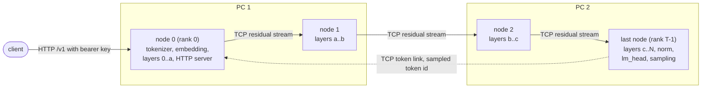
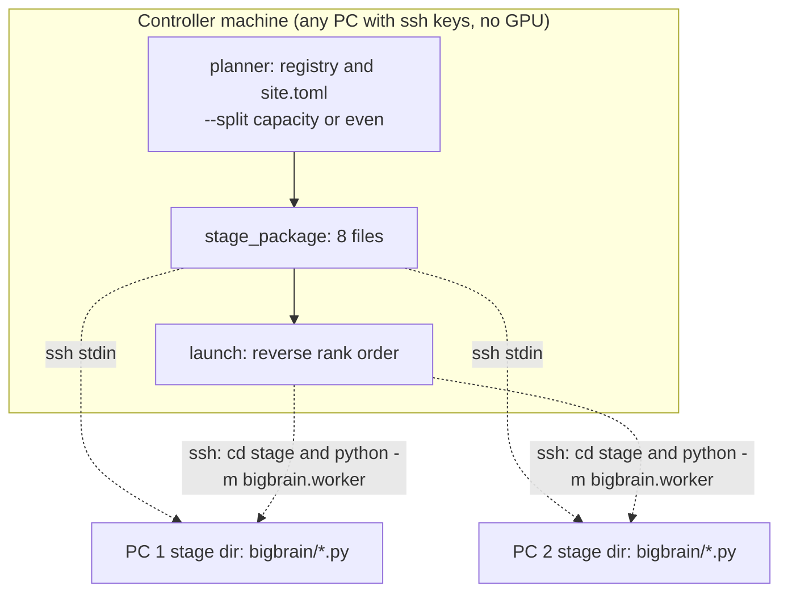

# BigBrain architecture

How the pipeline works, what travels over the wire, how several sequences and speculation share it, and how the controller plans a
split. Source references are to `src/bigbrain/` (the `bigbrain` package).

## What it does

One model is sharded across GPUs, usually on several machines. Each node loads a contiguous slice of the transformer layers into its own
VRAM, and the residual hidden state hops from node to node over TCP. The goal is to host models bigger than any one machine's VRAM
with all weights resident in VRAM (no NVMe streaming).



- **Pipeline parallelism, not tensor parallelism.** Node *i* owns layers `[start_i, end_i)`. Node 0 owns the tokenizer and the embedding and
  serves the HTTP endpoint; the last node owns the final norm, `lm_head` and sampling. One worker process drives one GPU
  (`--device cuda:N`); two GPUs in the same PC are two nodes joined by a loopback TCP hop.
- **The KV cache is per node.** exllamav3's attention is strictly intra-layer, so a node only needs the cache of its own layers.
- **Only token ids come back.** Sampling happens on the last node; node 0 receives the token id over the token link, never logits
  (the debug route `/v1/bigbrain/generate` can ask for them).
- **Hop cost.** The exllamav3 residual stream is fp32 (the receiver honours the frame header's dtype), so a decode step moves
  `hidden_size x 4` bytes per sequence per hop (times the stream count for hyper-connection models); for a hidden size of 2880 that is
  about 11 KB. A prefill chunk moves `tokens x hidden_size x 4` bytes, which on a 1 GbE link is network-bound, so prefill is chunked
  (`--prefill-chunk`, default 2048 tokens per hop) and the next node starts on a chunk while the previous node works on the next one.
  Decode is latency-bound rather than bandwidth-bound, which is why more nodes cost speed (see the measurements in the README).



## The slice-load core (`worker.py`)

exllamav3's `Model.modules` is a flat list `[Embedding, TransformerBlock x N, RMSNorm, lm_head]`. A worker keeps the blocks of its slice
(plus the modules attached to them: a `layer_idx`-less module such as a deep-stack embed belongs to the block before it, a negative
`layer_idx` module such as a per-layer embedding to the block after), the embedding on node 0, and the norm and head on the last node.
**Layer indices stay global by default**: exllamav3 builds the cache as a dict from the loaded modules only, keyed by
`(layer_idx, instance)`, so a slice `[40, 80)` simply has cache keys 40..79. `--rebase-layers` renumbers a slice to `0..n-1` instead.
The model's own module-list bookkeeping is recomputed for the shorter list, and hyper-connection sites are re-linked so a boundary
never hands off to a module that lives on another node.

Order of operations on a node: `Config.from_directory` -> `Model.from_config` -> filter the module list -> `Cache(model, max_num_tokens)`
attached **before** `model.load(device)` (the loader allocates the attached cache's tensors). Middle and last nodes never embed: they take
the activation and drive their slice with a self-built params dict through exllamav3's `prepare_for_attn`, which is why the exllamav3
version is pinned to the 1.6 line.

Things the code does because live runs showed they were needed:

- The residual stream is fp32, not fp16. The last node runs the epilogue (norm + head) through the normal module loop.
- Prefill feeds `prompt[:-1]` through every node and discards the result; the first token then comes from a decode step that feeds the last
  prompt token. (Feeding it twice would be harmless for attention but would make a recurrent layer consume it twice.)
- Every hop also carries the chunk's input token ids, because some layers (per-layer embeddings) need them on any node.
- Models with recurrent layers (Qwen3.5/3.8 GatedDeltaNet, gpt-oss's sliding-window state) need one state object per request on every
  node, passed unchanged to every step, created at the slot node 0 assigns, and released when the request ends. Every node holds a
  state even if its slice has no recurrent layer, because the architecture's input preparation requires one when `past_len > 0`.
- The cache pools are inference tensors, so every state entry point enters `torch.inference_mode`.
- Activations carry `requires_grad` from the kernels: they are `.detach()`ed before `.cpu().numpy()` on every send.
- Start-up race: every bind and connect happens in `__init__`, **before** the model load; connecting retries for up to 600 s (600 x 1 s);
  every accept happens after the load. The controller starts nodes in reverse rank order so listeners are up before connectors.

## Wire protocol (`pipe.py`)

Raw TCP, little-endian. Standard library plus numpy only. The header is 55 bytes in v2 (`<4sBBQIIIBIQQQ`): magic `BGBN`, version, message
type, seq id, batch, seq len, hidden dim, dtype, flags, payload length, and then `request_id` and `position` (v1 had no tail: 39 bytes, and v1
frames are still parsed). Any other version fails with "unsupported version N" and kills the link, because the stream is then desynchronised.

Message types: ACTIVATION (fp16 or fp32 `(batch, seq, hidden)`, or `(batch, seq, streams, hidden)` for hyper-connection models; a large
activation is split into frames along the sequence axis and the last carries `FLAG_LAST_CHUNK`; `FLAG_PREFILL` marks a prompt chunk),
HEARTBEAT, RESET, READY, BYE, CONTROL (a JSON object), TOKEN (uint32 ids) and LOGITS (debug).

A daemon heartbeat every 0.5 s keeps idle links alive. The receiver's watchdog (`--watchdog-s`, default 5 s, minimum 2 s) raises
`BigBrainPeerDead` when no bytes at all arrive in that window, and the link logs the longest silence between frames (a warning above 2 s)
so a watchdog value can be chosen from a measured gap.

Batched mode adds CONTROL ops on the same links, with `request_id` = the step id:

| op | direction | meaning |
|---|---|---|
| `hello` / `hello_ack` | 0 -> last, each node appends its capabilities; last -> 0 | `{proto, slots, ctx, batched, needs_history, max_draft, recurrent}`; node 0 refuses a pipeline that lacks any of them |
| `seq_begin` / `seq_end` | 0 -> all | a sequence takes / frees its slot on every node (sampling settings go to the last node) |
| `step` + ACTIVATION | node i -> i+1 | the rows (`rid, slot, pos, n, ids`), `T`, `packed`; then the residual |
| `result` | last -> 0 | per row the committed tokens (and `margins` with `--diag`); a prefill step answers with an empty ack |
| `error` | any -> 0 | `{step, rids, message}`: only the rows of that step fail |
| `stats` / `stats_result` | 0 -> all -> 0 | per-node timers, counters, rollbacks, VRAM |

Single-sequence mode (`--slots 1`, no speculation) sends the older, simpler frames (`begin` / `end`), and new workers still serve them.
The batched mode needs **every node on the same engine code**: an old worker relays `hello` but never answers it, so `start()` fails with a
clear message instead of hanging. The two traffic styles cannot be mixed on one pipeline; the controller always stages one consistent set
of files.

## Several sequences in flight, and speculation (`engine.py`, `paged.py`, `spec.py`, `draft.py`)

**Several sequences.** `--slots N` (every node, same value) gives the cache N sequences; slot *s* owns pages `[s*P, (s+1)*P)` of 256 tokens, with
P = context pages + 1 slack page. A step is a rectangular `(B, T)` micro-batch of decode rows (or one prefill chunk) run as exllamav3's paged
batch. Steps in flight are capped at `--inflight` (default: the number of nodes), each with up to `--mb-size` sequences. While node *k* computes
step A, node *k+1* computes step B. Node 0 computes its slice in the driver thread and sends through a per-link sender thread so the next
step overlaps the last one's write. The server runs one scheduler thread per slot; extra requests wait in a bounded queue (503 +
`Retry-After` when it is full). `--slots 1` without speculation keeps the single-sequence layout and traffic.

**Speculative decoding (greedy requests).** A decode row is `[last committed token, d_1..d_k]`, verified in ONE forward pass; draft `d_i` is
accepted iff all earlier ones were and the target's greedy token at that position equals it; the row commits the accepted drafts plus the
target's own next token. Every committed token is the target's greedy token for a prefix it actually saw, so the output equals plain greedy
decoding. Acceptance runs on the last node. Drafters: `ngram` (prompt lookup on node 0, no model) and `model` (a small model on node 0's
machine with the same tokenizer, checked by `draft.check_same_tokenizer`). `--spec-k` is the most drafts per round, and per sequence the window
shrinks when acceptance is poor and grows when it is full (`AdaptiveWindow`). Sampled (non-greedy) requests never carry drafts. A request is
greedy when `temperature` is 0 or `top_k` is 1; a client that wants speculation must say so.

**Rollback, on every node, independently.** Each step names the position it starts at; a node that has written past it (a rejected tail, or the
padding of a ragged batch) rolls that sequence back in `paged.PagedSlots.prepare`: the attention cache is truncated by `cache_seqlens`, a
recurrent state is rewound (`state.rewind(n)`). gpt-oss's sliding-window layers are recurrent state in exllamav3 (`SlidingAttention` +
`SWAState`, rewindable inside the stored window), and GatedDeltaNet layers rewind from per-token history, so speculation there needs
`--max-draft >= k` on every node (the handshake refuses a pipeline without it). A step that starts beyond what a node holds is an error,
never a guess.

**Ragged batches.** Rows of different draft length share a step padded to the longest; the pad positions are just more rejected positions
(causal attention means they never change a real row), and they cross the wire packed.

**Failure behaviour.** A sequence starts decoding only after the last node acknowledged its whole prefill, so a prefill chunk that fails on a
node fails that sequence only. A failed step fails the rows of that step. A drafter that raises drops its sequences to plain decode. A dead
link, a handshake that never completes, or a step with no result for 900 s marks the engine dead: `/health` reports `engine.dead` (503) and
there is no automatic recovery.

### What is proven, what is measured

Proven on CPU with fake per-node layers whose "model" is a deterministic function of the token history (`tests/bigbrain_speed_fakes.py`: a
paged full-attention layer and a sliding-window layer over a rewindable recurrent state, both sensitive to a missed rollback): for 1, 2 and 3
nodes and N = 3..4 concurrent sequences x {no speculation, n-gram, draft model}, every greedy output is IDENTICAL to the plain
single-sequence run and to a cache-free oracle. **Not provable without GPUs:** exllamav3's kernels are not promised batch-invariant, so a
`(B, T)` forward may round a logit differently from a `(1, 1)` one and flip an argmax where the top two are within rounding. Byte-identity on
real hardware is a MEASURED property: `bench.py` reports, per cell and per prompt, identical or the first divergent position with the plain run's
logit margin there (`bigbrain-bench grid ...`, `compare before.json after.json`). In an early acceptance run (a 1.5B model with 28
layers on two nodes of one PC) the 256-token greedy output was byte-identical to the monolithic baseline, with a max logit difference of 0.0; each
node held only its slice's weights and KV.

## The controller side

- `site.py`: reads `site.toml` (ssh user, host names, registry path, optional capacity reader). It reads files and the environment and nothing else.
- `registry.py` + `model_registry.json` (data, not in the repo): which model folder is on which PC, each PC's GPUs, its ssh user, its venv python,
  its LAN speed. `build_registry.py` measures all of it over ssh (read-only) and rewrites the file. `merge_models.py` merges an audit of what is
  still on disk (`missing_on`). See CONFIGURATION.md.
- `controller.py`: `plan_auto` (even split), `plan_capacity` / `choose_gpus` (layers in proportion to each GPU's usable memory, embedding on node 0,
  lm_head on the last, KV only on attention layers, N slots and a draft model priced), `stage_package` (ships `PACKAGE_FILES` to each host over
  ssh stdin), `launch` (reverse rank order so listeners are up before connectors), `teardown_command` (signals every node, worker or server,
  started with `-m bigbrain.X` or with `-c "from bigbrain import X ..."`, whose working directory is the stage dir), and the CLI.
  `--split capacity` reads each card's free memory through `nvidia_smi_free_mib` (one read-only `nvidia-smi` per PC over ssh) or through a reader you name in `site.toml`.
- `footprint.py`: `kv_shape`, the K+V elements one token adds to the cache for a given `config.json`. A lower bound by design: a missing field answers 0, never a guess.
- `parity_check.py`: formal parity of a pipeline against the monolithic model (token-for-token and logit fidelity).
- `bench.py`: the grid (slots x speculation) against a running endpoint, with the parity check.

## Memory planning in one formula

```
usable_i = free_i - headroom;   fixed_i = overhead + [i = 0] embedding + [i = last] lm_head;   budget_i = usable_i - fixed_i
cost_l   = weights_l + kv_bytes_per_token_l * cache_tokens + recurrent_l * slots      (KV is fp16, the worker's cache)
cache_tokens = slots * (ceil(ctx / 256) + 1) * 256     (batched layout: each slot's context plus one slack page; ctx for one slot, no speculation)
```

A GatedDeltaNet layer keeps `1 + k` recurrent states per slot while speculating with `--spec-k k`; a sliding-window layer's state rewinds in place and needs
no extra.

Cut the contiguous blocks so each node's share of the total cost is in proportion to its budget; if rounding to whole layers overflows a card, a
min-max fallback runs. Refused when total cost > total budget, a node cannot hold its fixed part, or no contiguous split fits; the reason names
the numbers. The defaults are `headroom` 1024 MiB per GPU and `overhead` 1024 MiB per worker process (`--headroom-mib`, `--node-overhead-mib`).
