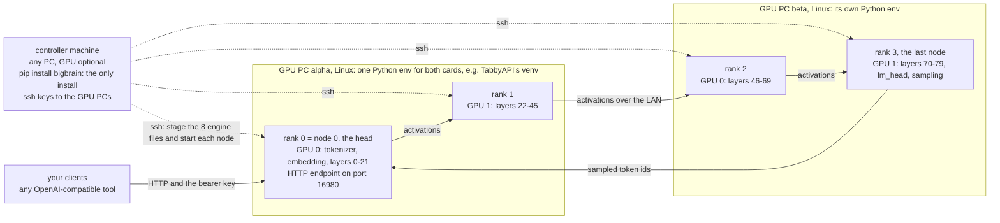

# Installing BigBrain

BigBrain is a pip package (import name `bigbrain`, v0.2.1). You install it on **one controller machine** (any machine with Python and
ssh keys to your GPU PCs; it needs no GPU): that gives you the commands below. The controller copies the eight engine files to each
GPU PC over ssh and starts the nodes, so the GPU PCs need nothing from this package, only a Python environment that already has
exllamav3 and torch.

```bash
python -m venv bigbrain-env && . bigbrain-env/bin/activate                    # Windows: py -m venv bigbrain-env ; bigbrain-env\Scripts\activate
pip install "git+https://github.com/dadbodnerd/bigbrain.git"                  # the controller machine: numpy + jinja2 + the commands
pip install "git+https://github.com/dadbodnerd/bigbrain.git@v0.2.1"          # the same, pinned to a release tag
bigbrain-controller --help                                                    # it works if this prints a usage text
```

| command | what it is (same as `python -m bigbrain.<module>`) |
|---|---|
| `bigbrain-controller` | `bigbrain.controller`: plan a cluster, print the node commands, and with `--execute` stage and start it over ssh |
| `bigbrain-registry` | `bigbrain.build_registry`: measure the GPU PCs over ssh and write `model_registry.json` |
| `bigbrain-merge-models` | `bigbrain.merge_models`: add newly measured models to a registry without touching the rest |
| `bigbrain-node` | `bigbrain.worker`: one pipeline node; with `--http-port` it is node 0, the OpenAI-compatible endpoint |
| `bigbrain-server` | `bigbrain.server`: node 0 as the endpoint, explicitly |
| `bigbrain-bench` | `bigbrain.bench`: the speed grid and the parity proof against a running server |
| `bigbrain-parity` | `bigbrain.parity_check`: the pipeline against a one-GPU reference |

The controller starts the nodes itself (`python -m bigbrain.worker` from the staged copy), so you normally run only `bigbrain-controller`,
`bigbrain-registry` and `bigbrain-bench` yourself. The other commands are for starting a node by hand.

## How a BigBrain cluster is laid out



**A rank is one GPU.** Each rank is a separate process (a *node*) that holds a contiguous slice of the model's layers on one GPU. The
residual stream hops from rank to rank over TCP; the last rank samples the next token and sends its id back to rank 0. Two GPUs in
one PC are two ranks joined by a loopback TCP hop.

### The three roles

| machine | what runs there | what it needs | BigBrain installed? |
|---|---|---|---|
| **Controller machine** | `bigbrain-controller` (plans, stages, starts the nodes, then waits in the foreground), `bigbrain-registry`, `bigbrain-bench` | Python 3.11+, pip, an OpenSSH client and key login to every GPU PC. No GPU, no torch. Linux is what the live runs used; on Windows the test suite passes, but the controller has not driven a live cluster from there | **yes**: `pip install`, the only install |
| **Every GPU PC** | one node per GPU of the plan, started by the controller over ssh with that PC's Python, from the staged files in `~/.cache/bigbrain/stage` | Linux, the NVIDIA driver and `nvidia-smi`, a POSIX login shell (bash, dash, zsh: the controller sends `cd ... && python -m ...`), `python3` on the PATH (`bigbrain-registry` runs `python3 -` there), and **one** Python environment with torch (CUDA), exllamav3 `>=1.6.0,<1.7`, numpy `>=1.24` and jinja2 `>=3.1.6`. The model folder on its local disk | **no**: the controller copies the 8 engine files at every launch |
| **Node 0, the head** | one of the GPU PCs. Rank 0 holds the tokenizer, the embedding and the first layers, and serves the HTTP endpoint (`--serve-port`); it reads the bearer key from `<stage-root>/api_key`, which the controller puts there (mode 0600) | the same as any GPU PC. jinja2 is imported only here, and node 0 refuses to start with a jinja2 older than 3.1.6 | no |

**Per session:** every `--execute` copies the engine files again (a few hundred KB over ssh stdin), so every node runs exactly the
controller's version of BigBrain. Nothing is installed on the GPU PCs and nothing keeps running after the cluster stops; the stage
directory keeps the files, the logs and `api_key` until the next launch overwrites them.

### One Python environment per GPU PC

All GPUs of a PC can share one environment: each node is its own process with that interpreter. **The venv of an existing TabbyAPI
install works as that environment, and this is how the author's cluster runs.** BigBrain does not use TabbyAPI itself (no TabbyAPI
process, no TabbyAPI code); it only borrows the interpreter and the packages installed with it. Check them first:

```bash
/home/bigbrain/tabbyAPI/venv/bin/python -m pip show torch exllamav3 numpy jinja2 | grep -E "^(Name|Version)"
/home/bigbrain/tabbyAPI/venv/bin/python -c "import torch; print(torch.cuda.device_count(), 'GPU(s)')"
```

- **exllamav3 must be 1.6.x.** BigBrain imports exllamav3 internals. If the TabbyAPI venv carries another version, give BigBrain its own
  venv (section 2) instead of changing TabbyAPI's.
- **jinja2 must be 3.1.6 or newer** (the chat-template sandbox; see SECURITY.md). Many existing venvs have an older 3.1.x; upgrading it is
  a patch release: `/home/bigbrain/tabbyAPI/venv/bin/python -m pip install -U "jinja2>=3.1.6"`.
- **Give BigBrain the cards.** A running TabbyAPI holds VRAM on its cards; stop it (or unload its models) on the GPUs BigBrain uses. The
  capacity split counts memory another process holds as used.

A fresh venv works just as well; section 2 has the commands.

### Different environments for different ranks

The interpreter is chosen **per PC in the registry and per rank on the command line**; `site.toml` has no interpreter setting.

| where | key | applies to |
|---|---|---|
| `model_registry.json` | `nodes.<name>.python`, for example `"/opt/venvs/exl3/bin/python"` (set by hand; `bigbrain-registry` keeps it when it rebuilds) | every rank on that PC |
| controller flag | `--node-python BIN`, repeated **in rank order** | rank 0, 1, ... for as many as you give (to change rank 2, give ranks 0, 1 and 2) |
| controller flag | `--python-bin BIN` (default `python`, whatever the login shell finds first) | every rank that has neither of the above |

So two PCs with two different venvs need nothing but their two `python` entries in the registry (the example below does exactly that:
alpha runs TabbyAPI's venv, beta a newer one). Two venvs on **one** PC, say a newer one for GPU 0 and an older one for GPU 1, take
`--node-python`: `--node-python /opt/venvs/new/bin/python --node-python /opt/venvs/old/bin/python ...`. The environments may differ,
but each needs exllamav3 1.6.x, and every rank runs the same staged BigBrain files.

### Which GPU each rank uses

- **The order of the plan is the order of the pipeline.** `--gpus HOST:INDEX`, repeated, lists the cards in rank order; `--all-cards` takes
  every card of the `--hosts` PCs (PCs in the order you name them, cards in registry order); `--node HOST:INDEX:START:END:INPORT` is fully
  explicit. HOST is a registry name or address; prefer the address with `--gpus` / `--node`, because the nodes use HOST as given to reach
  each other.
- **INDEX is `nvidia-smi`'s index.** The controller starts every node with `CUDA_DEVICE_ORDER=PCI_BUS_ID` and `--device cuda:INDEX`, which
  makes `cuda:N` the card `nvidia-smi` calls N, also in a PC that mixes GPU generations.
- **There is no UUID setting.** Neither the controller nor the registry addresses a card by UUID, and the controller does not set
  `CUDA_VISIBLE_DEVICES`. Do not set `CUDA_VISIBLE_DEVICES` in the ssh user's shell start-up files on a GPU PC: it renumbers the cards, and
  `cuda:N` would then be another card than the one the plan sized.
- **Indexes can change.** They follow the PCI bus order, so adding, removing or moving a card can renumber the others. That is why a UUID
  (which belongs to the card, not to a slot) is the safer key wherever you can use one. After any hardware change, re-run
  `bigbrain-registry --write` and look at `nvidia-smi --query-gpu=index,uuid,name,pci.bus_id,memory.total --format=csv` before you plan.
- **Pinning by UUID** is possible for a node you start by hand (`deploy/run_node.sh`, OPERATIONS.md): put
  `export CUDA_VISIBLE_DEVICES=GPU-<uuid>` in that node's `node.env` and `--device cuda:0` in its `node.args`.

### How the layers are split

| `--split` | what it does |
|---|---|
| `capacity` (the default with `--model`) | reads each card's free memory with `nvidia-smi` over ssh (also in a dry run), keeps 1 GiB headroom and 1 GiB runtime overhead per card, prices the embedding (rank 0), the LM head (last rank) and the KV cache of `--slots` x `--max-num-tokens`, and gives each card layers in proportion to the room left. It refuses a plan that does not fit and says how many MiB are missing |
| `even` | the same number of layers on every card; reads no memory and checks none. The layer count comes from the model's `config.json` (locally, else over ssh) or `--total-blocks N` |
| explicit `--node` | you choose every slice: `--node HOST:INDEX:START:END:INPORT` per rank (layers `[START, END)`, contiguous from 0), plus `--token-port`. INPORT is 0 for rank 0 and a free port for every other rank |

### A worked example: two PCs, four GPUs

alpha (10.0.0.11) has two RTX 3090 and TabbyAPI's venv; beta (10.0.0.12) has an RTX 3090 and an RTX 3060 and its own venv. The model
folder `Llama-3.3-70B-Instruct-4.0bpw-exl3` (80 layers) is on both, under different roots. All values are examples.

`~/.config/bigbrain/site.toml` on the controller machine:

```toml
[ssh]
user = "bigbrain"                      # the same login on both PCs

[registry]
path = "model_registry.json"           # relative to this file: ~/.config/bigbrain/model_registry.json

[hosts.alpha]
address = "10.0.0.11"

[hosts.beta]
address = "10.0.0.12"
```

`model_registry.json`, as `bigbrain-registry --write` measures it, with the two `python` lines added by hand (trimmed to what the planner
reads; `examples/model_registry.example.json` shows every field):

```json
{
 "version": 1,
 "nodes": {
  "alpha": {"host": "10.0.0.11", "python": "/home/bigbrain/tabbyAPI/venv/bin/python", "model_root": "/data/models",
            "gpus": [{"index": 0, "name": "NVIDIA GeForce RTX 3090", "total_mib": 24576},
                     {"index": 1, "name": "NVIDIA GeForce RTX 3090", "total_mib": 24576}]},
  "beta":  {"host": "10.0.0.12", "python": "/opt/venvs/exl3/bin/python", "model_root": "/srv/models",
            "gpus": [{"index": 0, "name": "NVIDIA GeForce RTX 3090", "total_mib": 24576},
                     {"index": 1, "name": "NVIDIA GeForce RTX 3060", "total_mib": 12288}]}
 },
 "models": {
  "Llama-3.3-70B-Instruct-4.0bpw-exl3": {
   "arch": "llama", "layers": 80, "hidden_size": 8192, "vocab_size": 128256,
   "kv_elements_per_token": 163840, "size_gib": 35.2, "hybrid": false,
   "paths": {"alpha": "/data/models/Llama-3.3-70B-Instruct-4.0bpw-exl3",
             "beta":  "/srv/models/Llama-3.3-70B-Instruct-4.0bpw-exl3"}}
 }
}
```

The key and the plan (a dry run: it prints and stages nothing):

```bash
python -c "import secrets; print(secrets.token_hex(24))" > api_key && chmod 600 api_key
bigbrain-controller --model Llama-3.3-70B-Instruct-4.0bpw-exl3 --all-cards --hosts alpha,beta \
    --max-num-tokens 8192 --slots 4 --serve-port 16980 --api-key-file api_key
```

With all four cards idle, the capacity split gives the 3060 the fewest layers (this output was produced with fixed free-memory readings
of 23800 MiB per 3090 and 11800 MiB for the 3060; yours come from `nvidia-smi`):

```text
  node 0 alpha:0 layers [0, 22] need 15018 MiB of 22776 usable
  node 1 alpha:1 layers [22, 46] need 14104 MiB of 22776 usable
  node 2 beta:0 layers [46, 70] need 14104 MiB of 22776 usable
  node 3 beta:1 layers [70, 80] need 7476 MiB of 10776 usable
model: /data/models/Llama-3.3-70B-Instruct-4.0bpw-exl3  blocks: 80  nodes: 4
  node 0: umask 077 && bb_stage="$HOME"/.cache/bigbrain/stage && { [ -d "$bb_stage" ] && ... } && cd "$bb_stage" && CUDA_DEVICE_ORDER=PCI_BUS_ID
          /home/bigbrain/tabbyAPI/venv/bin/python -m bigbrain.worker --model-dir /data/models/Llama-3.3-70B-Instruct-4.0bpw-exl3
          --device cuda:0 --slice 0 22 --rank 0 --total 4 --max-num-tokens 8192 --next-host 10.0.0.11 --next-port 16900
          --token-port 16903 --http-port 16980 --api-key-file api_key --slots 4
  ... (nodes 1 to 3 alike: rank 2 and 3 use /opt/venvs/exl3/bin/python and /srv/models/...)
[dry-run] stage 8 files -> bigbrain@10.0.0.11:~/.cache/bigbrain/stage
[dry-run] stage 8 files -> bigbrain@10.0.0.12:~/.cache/bigbrain/stage
[dry-run] stage api_key (the key, mode 0600) -> bigbrain@10.0.0.11:~/.cache/bigbrain/stage/api_key
```

(Lines wrapped and the private-stage-dir check shortened to `...` here.) The same plan with an even split (20 layers per card, no memory
reading, not checked), or with your own layer counts:

```bash
bigbrain-controller --model Llama-3.3-70B-Instruct-4.0bpw-exl3 --all-cards --hosts alpha,beta --split even \
    --max-num-tokens 8192 --slots 4 --serve-port 16980 --api-key-file api_key
bigbrain-controller --model Llama-3.3-70B-Instruct-4.0bpw-exl3 --total-blocks 80 --token-port 16903 \
    --node 10.0.0.11:0:0:22:0 --node 10.0.0.11:1:22:44:16900 --node 10.0.0.12:0:44:66:16901 --node 10.0.0.12:1:66:80:16902 \
    --max-num-tokens 8192 --slots 4 --serve-port 16980 --api-key-file api_key
```

Add `--execute` to stage and start it. Then check it (section 5) and stop it (section 6).

### Platforms

**Linux is the primary and the tested platform for every GPU node, node 0 included.** What the code supports elsewhere:

- **The controller machine** may be Windows (Python and the OpenSSH client that ships with Windows): the test suite passes there, but the
  controller has not driven a live cluster from Windows. The live runs used a Linux controller. On Windows with Git Bash, set `MSYS_NO_PATHCONV=1` before passing a
  POSIX path such as `/data/models` (Git Bash rewrites it otherwise).
- **A Windows GPU node** works only by hand, and slower. The controller cannot stage or start it: its commands are POSIX shell, so mark
  that PC `"launch": false` in the registry. Install BigBrain in that PC's venv (the `pip install` above, plus torch and a Windows
  exllamav3 wheel), and start the node with `python -m bigbrain.worker` and the arguments of the controller's dry run for that rank; then
  the cluster has to be started by hand (`deploy/run_node.sh` on the Linux nodes), not with `--execute`. The author's Windows node was
  reached through an ssh tunnel (`--bind-host 127.0.0.1` on its listener, `--watchdog-s 30` on every node), and it cost speed (README:
  single stream 58 -> 43 tok/s for the same model).
- **Node 0 should be a Linux PC** that the controller can start: it is the one clients and the key live on.
- `deploy/run_node.sh` and the systemd unit are Linux only (POSIX shell, `systemctl --user`); the controller's teardown uses `pgrep` and
  `/proc`.

Use Linux for every GPU node.

## 1. Requirements

| where | what |
|---|---|
| Controller machine | Python 3.11 or newer (`tomllib` is why 3.11), `pip`, `git` if you install from a git URL, an `ssh` client, and key-based ssh login to every GPU PC. No torch, no GPU; pip brings numpy and jinja2. |
| Every GPU PC that holds a slice | Linux with NVIDIA GPUs and `nvidia-smi`; one Python environment with **exllamav3 `>=1.6.0,<1.7`**, a matching **torch** (CUDA), **numpy `>=1.24`** and **jinja2 `>=3.1.6`**; a POSIX login shell (the controller sends `cd ... && python -m ...` commands); `python3` on the PATH for the registry builder. The nodes in the author's cluster ran Python 3.12. `pip install bigbrain` is **not** needed there: the controller copies the files. |
| Models | An EXL3 quantisation folder (`config.json`, `*.safetensors`, tokenizer files) **on the local disk of every PC that will hold a slice**. Nothing copies weights for you. |
| Network | The PCs reach each other on TCP (ports below). A 1 GbE LAN is enough; see ARCHITECTURE.md for what crosses it. The network must be one you trust: the links between the nodes are not authenticated (SECURITY.md). |
| Tests only | a checkout and `pip install -e ".[dev]"` (numpy, jinja2, pytest, build, twine). torch is optional: without it about a fifth of the tests skip. |

The engine imports exllamav3 internals (`exllamav3.modules.attn.prepare_for_attn`, `exllamav3.cache.recurrent_util`). That is why the version
is pinned to the 1.6 line. Do not "just upgrade" exllamav3 on a node without running `bigbrain-parity` afterwards.

## 2. Prepare each GPU PC

1. Find (or create) the Python environment that has exllamav3 and check it (an existing TabbyAPI venv is fine: see
   [One Python environment per GPU PC](#one-python-environment-per-gpu-pc)):

   ```bash
   /opt/venvs/alpha/bin/python -m pip show exllamav3 jinja2 | grep -E "^(Name|Version)"   # exllamav3 1.6.x, jinja2 3.1.6 or newer
   /opt/venvs/alpha/bin/python -c "import torch, numpy, jinja2; print(torch.cuda.device_count(), 'GPU(s)')"
   ```

   Install exllamav3 and torch the way the [exllamav3 README](https://github.com/turboderp-org/exllamav3) tells you; the right torch
   build depends on your driver and GPU generation, so this repository does not guess it for you.

   **If you want pip to bring torch and exllamav3 too** (a fresh venv on a GPU PC), the `gpu` extra asks for `torch` and
   `exllamav3>=1.6.0,<1.7`. Do not run it first on a bare machine, for two reasons that are exllamav3's and torch's, not ours:

   - the **exllamav3 package on PyPI has no prebuilt CUDA extension**. Installing it from PyPI compiles one, which needs the CUDA toolkit
     (`nvcc`) and a C++ compiler on that PC, and takes a while. The prebuilt, CUDA-matched wheels are on
     [exllamav3's GitHub releases](https://github.com/turboderp-org/exllamav3/releases) (the file name carries the exllamav3 version,
     the CUDA build, the torch version and the Python tag, for example `exllamav3-1.6.1+cu128.torch2.10.0-cp312-cp312-linux_x86_64.whl`);
   - a plain `pip install torch` may pick a build that does not match your driver. Use the index URL for your CUDA version from pytorch.org.

   So, in the node's venv, in this order:

   ```bash
   pip install torch --index-url https://download.pytorch.org/whl/cu128        # the CUDA build that matches your driver (pytorch.org)
   pip install "https://github.com/turboderp-org/exllamav3/releases/download/v1.6.1/exllamav3-1.6.1+cu128.torch2.10.0-cp312-cp312-linux_x86_64.whl"
                                                                              # pick the wheel that matches your torch, CUDA and Python
   pip install "bigbrain[gpu] @ git+https://github.com/dadbodnerd/bigbrain.git"   # last: torch and exllamav3 are already there, so nothing is built
   ```

   The last line is optional on a node (the controller copies the engine files anyway); it also brings numpy and a jinja2 that is new
   enough. It is the way to get one venv that holds everything, for example for `bigbrain-parity` on a single GPU. The wheel's version
   (`1.6.1+cu128...` counts as 1.6.1) satisfies `exllamav3>=1.6.0,<1.7` and any installed torch satisfies `torch`, which is why pip builds
   and downloads neither. Without it, install numpy and jinja2 yourself: `pip install "numpy>=1.24" "jinja2>=3.1.6"`.

2. Put the model folder on local disk, for example `/data/models/gpt-oss-120b-4.0bpw-exl3/`. The folder name becomes the model name in
   the registry. Every PC that is going to hold a slice needs its own copy (the path may differ per PC).

3. Make sure the user you will log in as can run `nvidia-smi`. The controller stages the engine into `~/.cache/bigbrain/stage` on each
   PC (`--stage-root` for another: an absolute path or `~/...`). It creates the directory with mode 0700 and **refuses one that is a
   symlink, belongs to someone else, or is writable by group or others**, because the nodes run code from it. If an older run left
   `/tmp/bigbrain` behind, it is no longer used.

4. Open the TCP ports between the PCs. With the defaults, a pipeline of N nodes uses:

   | port | on | who connects to it |
   |---|---|---|
   | `16900 + i - 1` for node *i* >= 1 (16900, 16901, ...) | node *i* | node *i-1* (the activation link) |
   | `16900 + N - 1` (the token port) | node 0 | the last node (it sends back the sampled token id) |
   | the `--serve-port` you choose (examples use 16980) | node 0 | your clients (HTTP) |

   Example for `ufw` on a PC, allowing only your LAN (`10.0.0.0/24` here; use your own subnet, or better, only the other nodes' addresses
   for the 16900 range):

   ```bash
   sudo ufw allow from 10.0.0.0/24 to any port 16900:16920 proto tcp
   sudo ufw allow from 10.0.0.0/24 to any port 16980 proto tcp
   ```

   **Do not expose these ports beyond a trusted LAN** (see SECURITY.md): the activation and token links have no authentication, and
   prompts and answers cross them as plain token ids.

## 3. Set up the controller machine

Install the package (the commands at the top of this file). To work on the code instead, or to run the tests, use a checkout:

```bash
git clone https://github.com/dadbodnerd/bigbrain
cd bigbrain
python -m pip install -e ".[dev]"                   # an editable install: numpy, jinja2, pytest, build, twine
python -m pytest -q                                 # no GPU or network needed
```

`patches/` and `deploy/` are **not** part of the installed package: they are repo tools (`deploy/release.py`, `deploy/verify_stage.py`,
`patches/verify.py`) that you run from a checkout, and they use the installed `bigbrain` if there is one, else the checkout's `src/`.
Nor does pip install the templates: `site.example.toml` and `examples/model_registry.example.json` are in the repository (and in the
source distribution), so copy them from a clone.

The controller reaches every PC with `ssh -o BatchMode=yes -- USER@HOST ...`, so passwordless key login must already work:

```bash
ssh-keygen -t ed25519                              # if you have no key yet
ssh-copy-id bigbrain@10.0.0.11                     # once per PC
ssh -o BatchMode=yes bigbrain@10.0.0.11 true && echo ssh ok
```

### Site configuration

Everything that belongs to your network (ssh user, host names, where the registry lives) is in one file, `site.toml`. It is read from
`$BIGBRAIN_SITE` when that is set, else from `~/.config/bigbrain/site.toml` (`$XDG_CONFIG_HOME/bigbrain/site.toml`). **A `site.toml` in the
current directory is not read on its own** (since v0.2.1): it is named on stderr and ignored, so a checkout someone else prepared cannot
choose your hosts. Copy the template and edit it; every key is optional:

```bash
mkdir -p ~/.config/bigbrain && cp site.example.toml ~/.config/bigbrain/site.toml
# or keep it anywhere and:  export BIGBRAIN_SITE=/path/to/site.toml
```

At minimum set `[ssh] user`. `[hosts.NAME] address = "..."` gives a PC a short name for `deploy/release.py --host NAME`. Host addresses
and user names are checked (an IP address or a host name; a POSIX-style user name). CONFIGURATION.md describes every key.

### The model registry

The planner needs to know which model folder is on which PC and which GPUs each PC has. `bigbrain-registry` measures all of it over ssh
(read-only: `nvidia-smi`, the `config.json` and `.safetensors` headers of each model folder) and writes `model_registry.json`:

```bash
bigbrain-registry --write --registry ~/.config/bigbrain/model_registry.json \
    --node alpha=10.0.0.11:/data/models --node beta=10.0.0.12:/srv/models
```

`--node NAME=HOST:MODEL_ROOT` is repeatable; every sub-folder of `MODEL_ROOT` that has a `config.json` is registered as a model. Leave out
`--write` to print the result without writing it. Re-run it whenever you add a model or change a GPU: it fills in what is new and never
discards the fields you set by hand.

Then edit `model_registry.json` once and set, per node, **`python`**: the interpreter that has exllamav3 (for example
`/opt/venvs/alpha/bin/python`, or TabbyAPI's `venv/bin/python`). Without it the controller starts `python`, whatever that resolves to in
the remote login shell. Hand-set fields (`python`, `user`, `aliases`, `launch`, `launch_blocker`, `link_mb_s`, `loopback_mb_s`, `notes`)
survive a rebuild. `examples/model_registry.example.json` shows every field. Point BigBrain at the file with `[registry] path` in
`site.toml` (relative to the site file) or with `$BIGBRAIN_REGISTRY`. With a pip install and no site file,
`export BIGBRAIN_REGISTRY="$PWD/model_registry.json"` is all it takes (the ssh user then defaults to your local user name).

## 4. Plan, then start

The controller is a **dry run unless you pass `--execute`**. It prints the layer split and the exact command for every node, and it
stages nothing:

```bash
python -c "import secrets; print(secrets.token_hex(24))" > api_key && chmod 600 api_key    # the bearer key (at least 16 characters)
bigbrain-controller \
    --model gpt-oss-120b-4.0bpw-exl3 --all-cards --hosts alpha,beta \
    --max-num-tokens 16384 --slots 4 \
    --serve-port 16980 --api-key-file api_key
```

- `--model NAME` resolves each PC's model path and python from the registry. `--all-cards` uses every GPU of the `--hosts` PCs that
  have the model (or name cards yourself, in pipeline order: `--gpus 10.0.0.11:0 --gpus 10.0.0.11:1 --gpus 10.0.0.12:0`).
- The split is **by free memory** (`--split capacity`, the default with `--model`). It reads each card's free memory with `nvidia-smi`
  over ssh (read-only, also in a dry run). `--split even` cuts by layer count and reads no memory; it takes the layer count from the
  model's `config.json` (locally, else over ssh) or from `--total-blocks N`. With `--model-dir PATH` instead of `--model` there is no
  registry and `--split even` is the only choice.
- `--max-num-tokens` is the context **per slot** (a multiple of 256); `--slots` is how many sequences run at once. Both are priced into
  the plan. If the cards cannot hold the model at that size the controller refuses and says how many MiB short it is: lower the slots or
  the context, or add a card.
- A plan with several slots or speculation needs `--serve-port` (the HTTP endpoint on node 0) and a key: `--api-key-file PATH`, or the
  environment variable `BIGBRAIN_API_KEY`. The controller sends the key over ssh into `<stage-root>/api_key` (mode 0600) on node 0; it is
  never on a command line and never printed. (`--api-token KEY` still works but is deprecated: it puts the key on the controller's own
  command line.)

When the plan looks right, add `--execute`. The controller stages the eight engine files to the stage directory on every PC (over ssh
stdin), the key file on node 0, starts the nodes in reverse rank order (listeners first), and then stays in the foreground, polling
them. Run it in `tmux`/`screen`. Each node writes `<stage-root>/node_<rank>.log` on its own PC. Loading a 60 GB model takes minutes;
follow a log with `ssh bigbrain@10.0.0.11 tail -f .cache/bigbrain/stage/node_0.log` (relative to the remote home).

For the speed features see `--spec-draft ngram` (prompt lookup, no extra model) and `--spec-draft model --spec-model DIR` (a small draft
model with the same tokenizer, on node 0's PC); CONFIGURATION.md lists the flags.

## 5. Check that it works

```bash
curl -s http://10.0.0.11:16980/health                        # 200 once every node has loaded and shaken hands; 503 before
curl -s http://10.0.0.11:16980/v1/models -H "Authorization: Bearer $(cat api_key)"
curl -s http://10.0.0.11:16980/v1/chat/completions -H "Authorization: Bearer $(cat api_key)" \
     -H "Content-Type: application/json" \
     -d '{"messages":[{"role":"user","content":"Name three prime numbers."}],"max_tokens":48,"temperature":0}'
```

`docs/API.md` lists the routes. If `/health` stays at 503, send it the key (`-H "Authorization: Bearer $(cat api_key)"`) to see why the
pipeline is down, and read the node logs. To check that the pipeline computes what a single GPU would, and to measure speed:

```bash
bigbrain-bench grid --url http://10.0.0.11:16980 --key-file api_key --concurrency 1 4 --spec none ngram
```

`bigbrain-parity` compares a running server against a one-GPU reference dump (it has `reference`, `run`, `compare` and `http`
sub-commands; read its `--help`).

## 6. Stop it

Stop node 0's process (SIGTERM; Ctrl-C on the controller does not stop the nodes): node 0 tells the other nodes to exit and every node
frees its VRAM. To signal every node of one stage directory on a PC, print the teardown command and run it there:

```bash
python -c "from bigbrain.controller import teardown_command; print(teardown_command('~/.cache/bigbrain/stage'))"
# run the printed line on each PC:  ssh bigbrain@10.0.0.11 '<the printed line>'
```

It signals only BigBrain processes whose working directory is that stage directory, and always exits 0. Use `sig="KILL"` for a stuck node.
It finds nodes started as `python -m bigbrain.worker` / `bigbrain.server` (what the controller and `deploy/run_node.sh` do) or from a
wrapper that does `from bigbrain import worker`. A node you started through the `bigbrain-node` or `bigbrain-server` command has no
module name in its command line: stop it with SIGTERM to node 0 (above) or through whatever started it.

## What is next

OPERATIONS.md covers running it day to day (health, metrics, releases, systemd, troubleshooting), CONFIGURATION.md every setting and
flag, ARCHITECTURE.md how it works, and SECURITY.md what the key does and does not protect.
